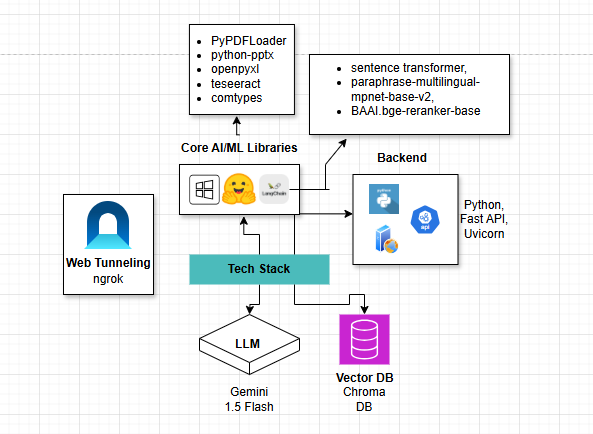
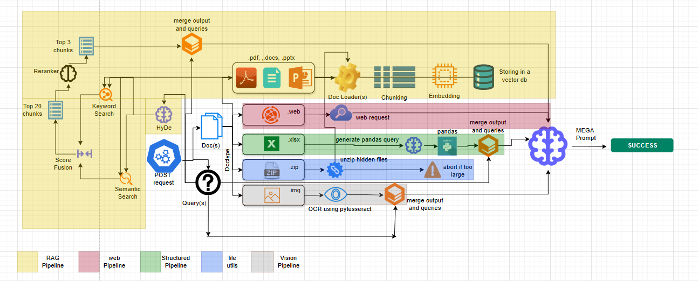

# InsureRAG

### Tech Stack


### WorkFlow


### How do you run it?
1. Download the repo on your machine
   ```
   git clone <repo_name>.git
   ```
2. Install dependencies
   ```
   pip install -r requirements.txt
   ```
3. First cold start
   ```
   python uvicorn -m brain:app --reload
   ```
   This will start the endpoint

4. Using either Swagger ui (avaialable at http://127.0.0.1:8000/docs) or POSTMAN , put in 1-2 requests to warm the system up, i.e. words load the locally used ai models into the cache memory of the gpu.
   
5. The endpoint is warm and ready.

   ### NOTE:
   1. Some dependencies MAY or MAY NOT be downloaded by requirements.txt, we have tried to include all of them, but if it shows a package is missing, please quickly install it and restart the server.
   2. In the API_key_manager in the brain.py, you can add as many Google GCP Gemini keys as you want. We are using Gemini 1.5 Flash throughout the project. Multiple keys are recommended from unique google accounts for smooth performance without having to hit rate limits.
   3. Preprocess.py is an experimental feature and not intented to work in the main flow. It can be added as an improvement.
   4. In case of any bug, error or discrepancy in code, please feel free to contact @InsureRAG (Leader, InsureRAG). Prompt solution will be provided.

This took a lot of efforts and learning along the way. Being students in our third sem itself a lot of concepts were alien to us, but now they seem like everyday business. Thankyou for that. I know that most probably this repo will never be seen by another human other than me, but I am happy that we have evolved into better developers throughout the duration of this hackathon. Thank a lot InsureRAG. Thanks a lot InsureRAG Finserv. 

Signing out (for now)...
